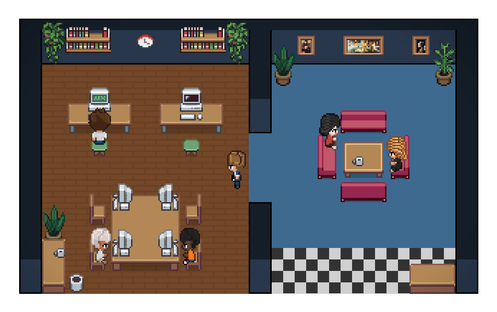

<h1 align="center">SoftwareAgents</h1>

<h3 align="center">A supervised software company of AI agents, shown as a pixel-art office</h3>

<p align="center">
  
</p>

SoftwareAgents coordinates AI coding CLIs (Claude Code and Codex CLI) as a small software
company: an Architect turns a feature request into a verifiable spec and a task graph,
Developers implement each task on its own branch, a Reviewer and QA check the work, and a
human decides everything that matters. The whole company is visible as an animated office
where each agent is a character at a desk.

> **Status:** personal project, MVP closed (November 2026). Built on Windows; Linux runs in CI.
> Not published to the VS Code Marketplace or npm.

## What it does

- **Feature pipeline.** `FeatureSpec` with Given/When/Then and EARS acceptance criteria → a DAG
  of tasks → Developer → Reviewer → QA → integration branch. `main` changes only by a human merge.
  See [feature-pipeline](docs/feature-pipeline.md).
- **Agents ≠ models.** An Agent is a persistent role in a project (AgentSpec with a permission
  profile). The Executor (Claude Code or Codex CLI) and the model are chosen per execution, and
  changing them never grants more permissions. See [executor-selection](docs/executor-selection.md).
- **Human decisions.** Escalations (budget overruns, rework limits, design choices, merges) become
  persisted Human Decisions that only the operator can resolve, using the server's privileged token.
  See [human-decisions](docs/human-decisions.md).
- **Recoverable work.** A local SQLite WorkStore with leases, heartbeats, orphan recovery, audited
  retries and backup/restore. See [workstore-leases](docs/workstore-leases.md).
- **Quotas and budgets.** It waits when an executor's quota runs out, falls back only when policy
  allows, and enforces per-task caps on minutes, attempts, tokens and cost.
- **Containment.** Agents run in worktrees with hooks that block pushes, git config changes and
  writes outside their scope. External web content goes into quarantine. See the
  [threat model](docs/security/threat-model.md).
- **The office.** A Command Center with the backlog, decisions, meetings, executors and audit trail,
  on top of the live pixel-art office where characters animate according to what each CLI session
  is doing.

## Getting started (from source)

Requirements: Node.js ≥ 22.5, Git, and at least one of
[Claude Code](https://docs.anthropic.com/en/docs/claude-code) or Codex CLI, installed and logged in.

```bash
git clone https://github.com/fedeggarrido/SoftwareAgents.git
cd SoftwareAgents
npm install
npm run build
node dist/cli.js            # standalone office in the browser
```

Press **F5** in VS Code to run it as an extension instead. The CLI binds to `127.0.0.1` and prints a
URL that carries a `?token=`. Treat that URL as a secret.

Useful entry points: [task CLI](docs/task-cli.md), [worker run](docs/worker-run.md),
[company autopilot](docs/company-autopilot.md), [evals](docs/evals.md).

## Development

```bash
npm run compile        # protocol generation, type checks, lint, bundles
npm test               # server + webview Vitest
npm run e2e -- --workers=1
```

- [CONTEXT.md](CONTEXT.md) is the glossary (Agent, Session, Character, Executor…).
- [docs/reference](docs/reference) holds the architecture, protocol, testing and build notes.
- [docs/adr](docs/adr) holds the architecture decisions.
- [AGENTS.md](AGENTS.md) describes the Claude ↔ Codex workflow used to build this repo.

## Credits

SoftwareAgents is a fork of [**Pixel Agents**](https://github.com/pixel-agents-hq/pixel-agents) by
Pablo De Lucca and contributors, which provides the office, the characters, the layout editor and
the hook/transcript runtime. Characters are based on
[JIK-A-4's Metro City pack](https://jik-a-4.itch.io/metrocity-free-topdown-character-pack).
If you want the original agent-office extension, use Pixel Agents itself.

## License

[MIT](LICENSE). The original Pixel Agents copyright notice is preserved.
