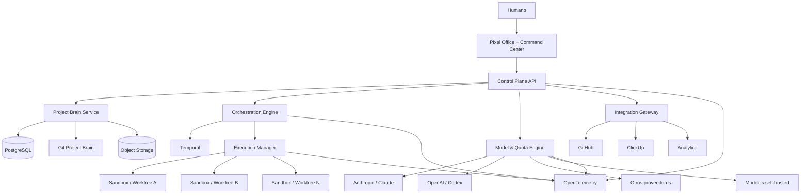
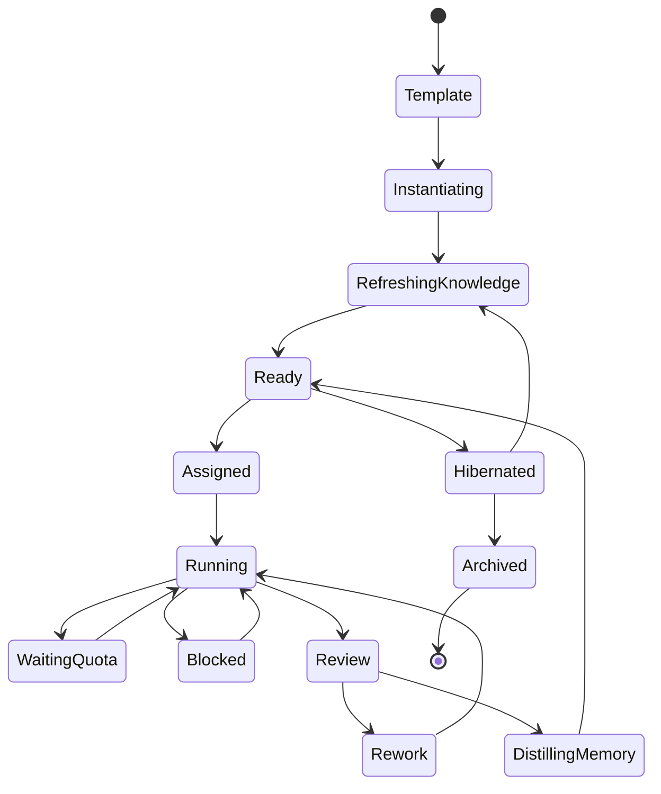
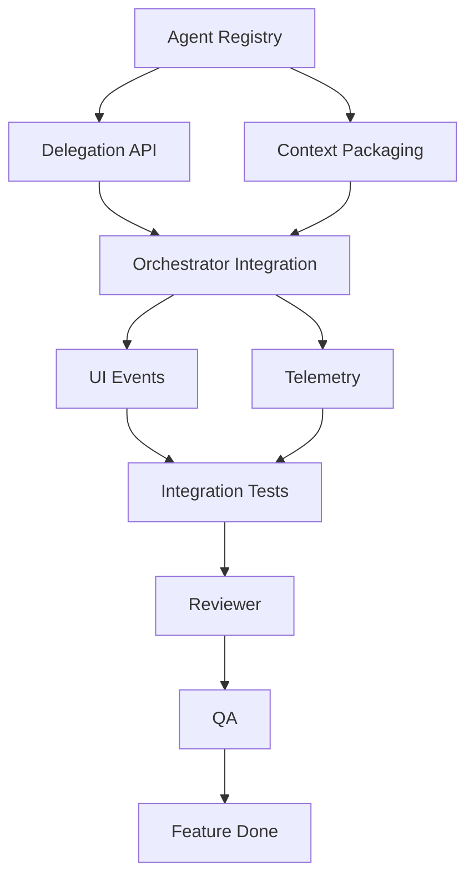
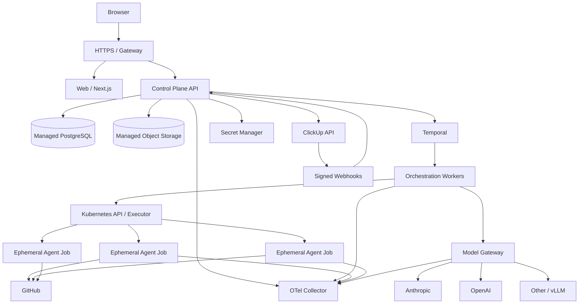

# SoftwareAgents: diseño de referencia y plan de implementación de una fábrica de software multiagente

## Resumen ejecutivo

**SoftwareAgents** —nombre de trabajo— debe concebirse como una **plataforma de ingeniería de software multiagente**, no como un videojuego que ejecuta prompts ni como una extensión de Fundtrinsic. Fundtrinsic es un proyecto independiente que hoy está sirviendo de campo de pruebas para el prototipo visual; el nuevo repositorio, la nueva arquitectura y el nuevo proyecto de ClickUp deben pertenecer exclusivamente a SoftwareAgents.

El flujo funcional que se debe preservar es el del diseño original: **Idea → investigación → proyecto → Product Owner → análisis de mercado/especialistas → concepto general → requisitos → trabajo estructurado → orquestación → desarrollo/DevOps/QA → feature → usuario/feedback → nueva iteración**. El diagrama original ya separa visualmente infraestructura, información y agentes, y sitúa al Product Owner, analista de demanda, especialistas, ClickUp, orquestador y feedback como piezas distintas; esa separación es correcta y debe convertirse en separación arquitectónica real. fileciteturn0file0

La recomendación principal es construir SoftwareAgents alrededor de seis principios:

| Decisión | Recomendación |
|---|---|
| Naturaleza del producto | **Software factory real; pixel office = control plane visual** |
| Fuente de verdad de conocimiento | Project Brain versionado en Git |
| Fuente de verdad operacional | PostgreSQL |
| Orquestación | Temporal + reglas deterministas + razonamiento AI solo donde aporte valor |
| Agentes | `AgentSpec` + conocimiento del proyecto + contexto actual; **Agent ≠ Model** |
| Ejecución de código | Sandbox aislado por tarea + rama/worktree + PR |
| Modelos | Gateway multi-proveedor con Claude, Codex/OpenAI y extensible a otros |
| Cuotas | Motor de recursos de primera clase, no una barra decorativa |
| UI | Next.js/React + Phaser + primitives accesibles; pixel-art para la oficina y UI profesional para el Command Center |
| Integraciones | GitHub App + ClickUp OAuth/API/webhooks |
| Infraestructura inicial | Docker desde el primer día; Kubernetes preparado, pero no impuesto al MVP |
| Producción | PostgreSQL gestionado + object storage gestionado + Temporal Cloud o equivalente |
| Observabilidad | OpenTelemetry + logs/métricas/trazas + auditoría separada |
| Seguridad | mínimo privilegio, secretos externos, RLS, sandboxes, egress controlado, aprobación humana para operaciones críticas |
| Filosofía de agentes | **Críticos y ágiles**: decisiones reversibles rápidas; decisiones irreversibles/riesgosas analizadas |

Temporal es especialmente adecuado para el núcleo porque mantiene un historial duradero de los workflows y permite reanudar la ejecución tras fallos, mientras que las Activities encapsulan efectos externos y reintentos. Eso es mucho más seguro que basar la ejecución de una fábrica de software únicamente en procesos LLM y colas caseras. citeturn4search0turn4search2turn4search3

Para evitar la confusión recursiva durante el desarrollo, recomiendo fijar desde el primer commit esta terminología:

> **SoftwareAgents Platform** = el producto que estamos construyendo.  
> **SoftwareAgents Development Project** = proyecto de ClickUp usado para construir SoftwareAgents.  
> **Managed Project** = cualquier proyecto que SoftwareAgents desarrolla para un usuario.  
> **Fundtrinsic** = proyecto independiente; no forma parte de SoftwareAgents.  
> **Pixel Office** = una de las interfaces de SoftwareAgents, no el producto entero.

La primera versión no debería intentar cerrar automáticamente todo el ciclo desde una idea hasta una empresa funcionando. El primer objetivo de producción debe ser un **vertical slice completo**:

```text
Usuario da una feature
        ↓
Requirements Analyst
        ↓
FeatureSpec
        ↓
Architect
        ↓
Technical Design + Task DAG
        ↓
Orchestrator
        ↓
Developer(s)
        ↓
Reviewer
        ↓
QA
        ↓
PR / artefacto listo
        ↓
Usuario
```

Todo ello debe suceder con **aislamiento de proyecto, seguimiento de costes/cuotas, permisos, auditoría, recuperación ante fallos y representación en la oficina pixel**. Una vez eso sea sólido, se añade hacia arriba Market/PO/Discovery y hacia abajo despliegue, usuarios sintéticos, telemetría y Feedback Engine.

## Principios y arquitectura de referencia

La arquitectura debe separar claramente **control**, **conocimiento**, **ejecución** y **presentación**. La oficina pixel nunca debe ser el lugar donde vive el estado verdadero de un agente: es una proyección visual del sistema.



**Control Plane.** Recomiendo TypeScript end-to-end para la primera versión: Next.js/React en frontend y un API independiente basado en Node.js/TypeScript y Fastify. Fastify soporta validación y serialización basadas en JSON Schema y tipado TypeScript, lo que encaja bien con contratos estrictos como `AgentSpec`, `FeatureSpec`, eventos y acciones. citeturn12search1turn14search2turn14search5

**Workflow Engine.** Temporal debe encargarse de la durabilidad de workflows, timers, retries, señales humanas y recuperación. No hay que convertir cada operación en un Child Workflow: la propia documentación de Temporal recomienda empezar de forma sencilla y utilizar Activities cuando son suficientes, reservando Child Workflows para unidades con ciclo de vida o necesidades de gestión propias. citeturn4search0turn4search5

**Executor.** El código no se ejecuta dentro del proceso del API ni dentro del proceso del orquestador. Cada tarea que pueda modificar código o ejecutar comandos obtiene un workspace aislado. En desarrollo/local puede ser un contenedor Docker unido a un `git worktree`; Git admite múltiples worktrees asociados al mismo repositorio, con ramas/HEAD independientes, lo que encaja muy bien con desarrolladores paralelos. citeturn16search1

En producción con Kubernetes, la unidad natural de ejecución es un **Job efímero por ejecución o por lote controlado de tareas**. Kubernetes Jobs están diseñados para workloads que deben terminar y pueden recrear Pods tras fallos; además, NetworkPolicy permite limitar las comunicaciones de esos Pods. citeturn14search1turn14search3turn14search6

No se debe montar `/var/run/docker.sock` dentro de agentes ni darles privilegios de host. Los ejecutores Kubernetes deberían usar el perfil `restricted` de Pod Security donde sea posible, ejecutarse sin privilegios, con usuario no-root, filesystem limitado, límites CPU/RAM y egress restringido. Kubernetes define explícitamente perfiles `privileged`, `baseline` y `restricted`, y dispone de Pod Security Admission para aplicarlos por namespace. citeturn15search0turn15search1turn15search10

### Stack recomendado

| Capa | Recomendación inicial | Razón | Alternativa / cuándo cambiar |
|---|---|---|---|
| Web | Next.js + React + TypeScript | Ecosistema, SSR/app shell, mismo lenguaje que control plane | Vite SPA si nunca se necesita SSR |
| Pixel Office | Phaser | Framework 2D maduro, WebGL/Canvas, sprites/scenes/input, integración web | PixiJS si solo se necesita rendering 2D |
| UI profesional | Radix Primitives + Tailwind/design tokens propios | Accesibilidad sin imponer estética | Otro design system adaptado al producto |
| API | Fastify + TypeScript | Contratos JSON Schema y bajo overhead | NestJS si el equipo prefiere arquitectura más opinionated |
| Workflows | Temporal | Durabilidad/reintentos/señales humanas | Implementación propia solo con razón fuerte |
| DB | PostgreSQL gestionado | Relaciones, JSONB, transacciones, RLS | Self-host para entornos regulados/especiales |
| Semantic retrieval | pgvector opcional | Mantiene embeddings junto a datos relacionales | Vector DB separado solo al superar necesidades reales |
| Blob storage | S3-compatible gestionado | Logs grandes, capturas, outputs, backups | MinIO para self-host |
| Git | GitHub | Repos/PR/Actions/App ecosystem | GitLab adapter futuro |
| Task system | DB interno + sincronización ClickUp | Control consistente | ClickUp nunca como única fuente operacional |
| Telemetría | OpenTelemetry | estándar vendor-neutral | backend de métricas/traces intercambiable |
| Dev local | Docker Compose | reproducibilidad sencilla | K8s local solo cuando se necesite |
| Producción inicial | Contenedores gestionados/VM + servicios managed | evita operar un clúster prematuramente | Managed Kubernetes al crecer concurrencia/aislamiento |
| Producción escalada | Managed Kubernetes | aislamiento de jobs, autoscaling, policies | self-host K8s solo si existe requisito concreto |
| IaC | Terraform/OpenTofu | infraestructura reproducible | IaC nativo cloud si se decide proveedor único |

Phaser se presenta oficialmente como framework HTML5 2D para navegador con WebGL/Canvas y soporte TypeScript; Radix ofrece primitives accesibles y sin estilo que permiten construir una identidad propia, justo lo que interesa para evitar el aspecto genérico de “dashboard hecho por IA”. citeturn3search0turn12search2turn12search7

OpenTelemetry ofrece un modelo vendor-neutral para señales como traces, metrics y logs, por lo que recomiendo instrumentar la aplicación contra OTel y decidir el backend de observabilidad aparte. citeturn3search14turn3search19

### Eventos, no animaciones falsas

La oficina debe escuchar eventos del dominio:

```text
agent.task.started
agent.research.started
agent.meeting.joined
task.blocked
task.review.requested
quota.warning
quota.exhausted
human.decision.required
deployment.started
deployment.succeeded
```

El estado visual se deriva de esos eventos.

No:

```text
"cada 20 segundos el personaje camina aleatoriamente"
```

Sí:

```text
Research iniciado
→ personaje se dirige a zona de investigación

Review solicitado
→ Reviewer recibe indicador y cambia de mesa/contexto

Quota agotada
→ agente pasa a WAITING_CAPACITY

Conflicto Architect/PO
→ reunión real
```

Para la primera versión no introduciría Kafka. Un **outbox transaccional en PostgreSQL + event relay** es suficiente. Si en el futuro hay muchas instancias del frontend/worker, Redis, NATS o un broker equivalente pueden introducirse detrás de la misma interfaz.

## Agentes, autonomía y orquestación

El concepto fundamental es:

> **Agent ≠ Model.**

Un `Developer` no es “Claude”. Un `Architect` no es “Codex”. Son entidades persistentes con constitución, permisos, memoria, conocimiento y política de modelos. El runtime decide qué modelo utilizar para una ejecución concreta.

El mismo agente puede pasar, si la política lo permite, de un modelo potente para un diseño difícil a uno más económico para una tarea sencilla sin perder su rol.

Cada agente tiene tres capas:

```text
Agent Core
├── rol
├── misión
├── principios
├── referentes conceptuales
├── anti-patrones
├── permisos
└── política de escalado

Project Knowledge
├── Project Brain
├── arquitectura
├── historial de decisiones
├── vocabulario
├── mercado
└── conocimiento acumulado

Current Context
├── tarea
├── artefactos pertinentes
├── dependencias
├── presupuesto
├── herramientas
└── contexto mínimo necesario
```

Los referentes humanos deben ser **influencias conceptuales, nunca una imitación de personalidad o voz**. Por ejemplo, de Linus Torvalds interesa el pragmatismo técnico; no se debe reproducir su estilo interpersonal.

### Plantilla `AgentSpec`

```yaml
apiVersion: softwareagents.io/v1alpha1
kind: AgentSpec

metadata:
  id: architect
  version: 1.0.0
  displayName: Architect / Tech Lead

identity:
  role: architect
  mission: >
    Diseñar la solución técnica más sencilla que satisfaga
    correctamente las necesidades del producto y permita evolucionar.
  principles:
    - Challenge assumptions, not people
    - Prefer simplicity over speculative abstraction
    - Reversible decisions should be fast
    - Critical decisions require evidence
    - Adopt mature tools before building equivalents
  referents:
    - name: John Carmack
      extractedPrinciples:
        - first-principles reasoning
        - deep technical understanding
    - name: Linus Torvalds
      extractedPrinciples:
        - pragmatism
        - simplicity
    - name: Martin Fowler
      extractedPrinciples:
        - evolutionary architecture
        - refactoring
  antiPatterns:
    - architecture astronautics
    - technology for prestige
    - premature microservices
    - blind obedience

knowledge:
  projectSources:
    - project-brain
    - source-code
    - accepted-adrs
    - feature-specs
  internetRefresh:
    enabled: true
    when:
      - unstable_technology
      - security_relevant
      - unknown_domain

capabilities:
  - read_repository
  - create_technical_design
  - create_task_dag
  - create_adr
  - code_spike
  - request_specialist

tools:
  allow:
    - git.read
    - git.branch
    - filesystem.project
    - tests.run
    - web.research
    - clickup.read
    - clickup.write_technical_tasks

permissions:
  profile: architect
  autonomyLevel: 3

modelPolicy:
  capabilityClass: high_reasoning
  preferredProviders: []
  fallbackAllowed: true
  maxTaskBudgetUsd: null

memory:
  episodicRetentionDays: 30
  distillAfterTask: true
  projectPromotionRequiresReview: true

outputs:
  - TechnicalDesign
  - ADR
  - TaskDAG

gates:
  mayBlock:
    - severe_architectural_risk
    - data_loss_risk
    - unsafe_security_design

escalation:
  humanRequired:
    - strategic_stack_change
    - major_recurring_cost
    - unresolved_product_technical_conflict
```

### Especificaciones iniciales de agentes

| Agente | Misión y forma de pensar | Referentes conceptuales propuestos | Autoridad principal | Output |
|---|---|---|---|---|
| **Product Owner** | Maximizar valor real para usuario y demanda; cuestionar features y simplicidad | Jobs, Musk, Pichai, Amancio Ortega, Pablo Isla, Bezos | Producto/roadmap/prioridades; pivotes estratégicos escalan | Vision, Product Brief, roadmap, prioridades |
| **Market Analyst** | Buscar evidencia a favor **y en contra**; escaneo periódico; experimentar | Bezos, Steve Blank, Christensen, Byron Sharp | Investigación y propuesta de experimentos; publicación/gasto escalan | Market Brief, señales, experimentos |
| **Domain Specialist** | Experto temporal, crítico y actualizado; profundiza si es necesario | Dinámicos según dominio | Advisory/Warning/Blocker; veto fuerte para seguridad/legal/data-loss según política | Expert Review |
| **Requirements Analyst** | Eliminar ambigüedad y descubrir edge cases | Jeff Patton, Eric Evans, Gojko Adzic, Fowler | Puede bloquear features incompletas/contradictorias | FeatureSpec |
| **Architect** | Solución técnica mínima correcta y evolutiva | Carmack, Torvalds, Fowler, Rich Hickey, Hightower | Máxima autoridad técnica | TechnicalDesign, ADR, TaskDAG |
| **Developer** | Comprender antes de escribir; cambios pequeños, correctos y probados | Torvalds, Carmack, Kent Beck, Fowler | Implementación dentro del diseño; puede desafiar arquitectura | commits, tests, PR |
| **Reviewer** | Detectar defectos reales, no ejercer preferencias de estilo | Torvalds, Carmack, Kent Beck, John Ousterhout | Aprobar/rechazar PR; bloquear correctness/security/maintainability | ReviewReport |
| **QA** | Intentar romper el comportamiento y validar criterios, no repetir tests del developer | James Bach, Cem Kaner, Elisabeth Hendrickson | Gate funcional; puede rechazar entrega | TestReport, defectos |
| **Orchestrator** | Maximizar flujo, resiliencia y utilización sin cambiar intención de producto | Goldratt, Gene Kim, Lamport como principios abstractos | Asignación, scheduling, retries, replanning dentro de policy | ExecutionPlan |
| **Designer** | Diseñar productos reconocibles, coherentes con usuarios y dominio, no “AI-looking” | referentes seleccionados por producto/diseño | UX/UI y design system; puede rechazar soluciones visuales genéricas | UX spec, prototypes, tokens/assets |

El `Domain Specialist` no debe vivir permanentemente consumiendo recursos. Se instancia desde una plantilla genérica, recibe `domain`, problema, contexto de proyecto y un paquete de fuentes actuales, produce un resultado y pasa a `HIBERNATED`. Su conocimiento adquirido queda versionado. Cuando se reactiva y el dominio es temporalmente sensible, ejecuta un refresh antes de opinar.



### Autonomía

La autonomía debe ser una política del proyecto y, además, limitarse por acción. Un agente jamás puede aumentarse a sí mismo sus permisos.

| Nivel | Significado | Ejemplos |
|---|---|---|
| **A0 Observe** | Solo lee/analiza | auditoría, análisis |
| **A1 Propose** | Produce propuestas, humano ejecuta/aprueba | roadmap inicial, ADR estratégica |
| **A2 Execute reversible** | Ejecuta acciones fácilmente reversibles | branch, tests, draft PR, staging |
| **A3 Project autonomous** | Gestiona trabajo normal del proyecto | tareas, PR, merges que cumplan policy |
| **A4 High autonomy** | Opera casi todo el ciclo y solo escala excepciones | proyecto autónomo maduro |

Incluso con A4, por defecto requieren gate humano: eliminación de repositorios/datos, cambio de permisos/autonomía, publicación pública en nombre del usuario, aceptación contractual, gasto fuera de límites, uso de secretos nuevos, bypass de seguridad, migraciones destructivas y cambios estratégicos de producto.

La regla común a los agentes debe ser:

> **Sé crítico, pero no burocrático. Si la decisión es reversible y está dentro de tu autoridad, decide. Si objetas, aporta una alternativa. Si el riesgo es alto o irreversible, detente y escala.**

### Separación de permisos

| Rol | Project Brain | Código | PR | Merge | Staging | Producción | Internet write/spend |
|---|---|---:|---:|---:|---:|---:|---:|
| PO | Producto W | R | R | — | R | — | Gate |
| Market | Research W | — | — | — | — | — | Gate |
| Specialist | Review W | R | comment | — | R | — | Gate |
| Requirements | FeatureSpec W | R | — | — | — | — | — |
| Architect | Technical W | W en spike | approve | policy | W | Gate | — |
| Developer | R | branch W | create | no directo | W | no | — |
| Reviewer | R | R | approve/reject | policy | R | no | — |
| QA | test docs W | R | report | no | W | Gate | — |
| Orchestrator | operational W | no directo | trigger | solo policy | trigger | Gate | no |
| Designer | design W | UI branch según perfil | create | no | W | no | asset licences según policy |

### Escalado

Se escala después de **una ronda de resolución**, no después de debates infinitos. El paquete de escalado debe incluir:

```text
DECISION REQUIRED

Context:
...

Option A:
benefit / cost / risk

Option B:
benefit / cost / risk

Agent recommendation:
B

Disagreement:
PO -> ...
Architect -> ...

Decision impact:
...

Urgency:
...
```

Se escala automáticamente cuando aparece un `CRITICAL_BLOCKER`, conflicto PO/Architect no resoluble, cuota agotada sin fallback permitido, presupuesto superado, riesgo de seguridad/legal, operación destructiva o decisión estratégica.

### Orquestación y Task DAG

El Orchestrator debe ser un sistema híbrido:

```text
DETERMINISTIC CORE
dependencies
permissions
task states
leases
timeouts
budgets
quota reservations
retries
locks
human gates
idempotency

        +

AI ORCHESTRATOR
ambiguous classification
replanning
agent selection when ambiguous
unexpected failure diagnosis
proposal of new specialist
```

Nunca utilizaremos un LLM para decidir que una tarea B no puede arrancar mientras A, de la que depende, no está terminada.



Estados recomendados:

```text
DRAFT
→ READY
→ QUEUED
→ LEASED
→ RUNNING
→ REVIEW
→ QA
→ DONE

Desvíos:
BLOCKED
FAILED_RETRYABLE
FAILED_FINAL
WAITING_HUMAN
WAITING_QUOTA
CANCELLED
```

Cada Task debe poseer un `version` para optimistic locking y una `lease_expires_at`. Si un worker muere, la lease expira y el workflow recupera el trabajo de forma segura. Cualquier Activity con efectos externos debe usar `idempotency_key`.

Una `Feature` puede mapearse a un Workflow de Temporal; tareas complejas con ciclo propio pueden ser Child Workflows, mientras que operaciones externas concretas —crear branch, ejecutar test, abrir PR, sincronizar ClickUp— son Activities. Temporal conserva Event History y reconstruye el estado del workflow al recuperarse. citeturn4search0turn4search3

## Persistencia, modelo de datos y Project Brain

El error más importante a evitar sería guardar “la memoria” únicamente en conversaciones de Claude/Codex.

La arquitectura debe reconocer distintos tipos de verdad:

| Información | Fuente canónica | Índice/cache | Backup |
|---|---|---|---|
| Código | GitHub/Git | checkout/worktree | mirror Git |
| Visión/PRD/ADRs/FeatureSpecs | **Project Brain en Git** | PostgreSQL + embeddings | mirror Git |
| Estado operativo de tareas/agentes | **PostgreSQL** | memoria/cache | PITR + snapshot |
| Archivos grandes, sesiones, screenshots | Object storage | metadata PostgreSQL | versioning/cross-region opcional |
| Agent templates | repo SoftwareAgents | DB compiled snapshot | Git |
| Agent instances | PostgreSQL | cache | DB backup |
| Episodic memory | PostgreSQL/object store | vector index opcional | según retention |
| Telemetría | observability backend | agregaciones | retention policy |
| Audit log | PostgreSQL append-only | búsqueda | archivo inmutable |
| Secretos | Secret Manager | nunca DB plaintext | servicio de secretos |
| Pesos de modelo self-hosted | model registry/object storage | cache GPU/node | object store |
| Cuotas/uso | PostgreSQL | cache scheduler | DB backup |

### Project Brain

Cada **Managed Project** tendrá un directorio declarativo:

```text
.softwareagents/
├── project.yaml
├── brain/
│   ├── VISION.md
│   ├── PRODUCT.md
│   ├── USERS.md
│   ├── MARKET.md
│   ├── ARCHITECTURE.md
│   ├── GLOSSARY.md
│   ├── CONSTRAINTS.md
│   ├── RULES.md
│   ├── decisions/
│   │   ├── ADR-0001-...
│   │   └── ADR-0002-...
│   ├── features/
│   │   └── FEAT-001.yaml
│   ├── technical-designs/
│   ├── research/
│   └── learnings/
└── agents/
    ├── overrides/
    └── project-policies.yaml
```

**Git será canónico para conocimiento declarativo. PostgreSQL será canónico para estado mutable.** Así se evita la pesadilla de tener dos versiones distintas de la misma FeatureSpec.

La base de datos conserva referencias como:

```text
FeatureSpec.doc_path
FeatureSpec.git_sha
ADR.doc_path
ADR.git_sha
Project.brain_head_sha
```

El vector store es **derivado**. Si desaparece, se reconstruye desde Project Brain. `pgvector` permite mantener búsqueda vectorial dentro de PostgreSQL, por lo que no introduciría una base vectorial independiente hasta demostrar que hace falta. citeturn8search6

### Memoria del agente

No usaría una “memoria infinita”. Cada agente tiene cuatro capas:

```text
Constitution
→ versionada, estable

Project Knowledge
→ Project Brain, compartido

Episodic Memory
→ lo ocurrido en ejecuciones concretas

Distilled Learning
→ conclusiones útiles extraídas de episodios
```

Una conclusión no entra automáticamente en conocimiento permanente porque un LLM la haya escrito. Debe conservar:

```text
statement
source
confidence
created_by
task_id
model
timestamp
review_status
supersedes
```

Y si se pretende promoverla a `Project Brain`, pasa por el agente responsable del área.

Una ejecución debe ser trazable mediante:

```text
agent_template_version
agent_instance_id
model_provider
model_id
model_parameters
system_prompt_hash
project_brain_sha
task_version
tool_policy_version
execution_id
```

No garantiza reproducibilidad bit a bit de una respuesta generativa, pero sí permite reconstruir exactamente **qué contexto y política** se utilizaron.

### Esquema lógico principal

Todos los IDs pueden ser UUID y todas las entidades de proyecto deben incluir `project_id`. En una futura modalidad multiusuario, también `organization_id`.

| Tabla | Campos principales |
|---|---|
| **Project** | `id`, `organization_id`, `slug`, `name`, `status`, `repo_provider`, `repo_id`, `default_branch`, `clickup_workspace_id`, `clickup_space_id`, `autonomy_level`, `budget_policy_json`, `brain_head_sha`, `created_at`, `updated_at` |
| **Agent** | `id`, `project_id`, `template_id`, `template_version`, `role`, `specialization`, `status`, `autonomy_level`, `model_policy_json`, `permission_profile`, `knowledge_snapshot_sha`, `last_refresh_at`, `instantiated_at`, `deactivated_at` |
| **FeatureSpec** | `id`, `project_id`, `key`, `version`, `status`, `title`, `goal`, `user_value`, `actors_json`, `flows_json`, `rules_json`, `edge_cases_json`, `acceptance_json`, `doc_path`, `git_sha`, `owner_agent_id`, timestamps |
| **Task** | `id`, `project_id`, `feature_spec_id`, `parent_task_id`, `key`, `type`, `status`, `priority`, `assigned_agent_id`, `required_capabilities_json`, `version`, `lease_expires_at`, `attempt`, `branch`, `worktree_ref`, `pr_ref`, `workflow_id`, `estimated_cost`, `actual_cost`, `blocked_reason`, timestamps |
| **ADR** | `id`, `project_id`, `number`, `title`, `status`, `context`, `options_json`, `decision`, `consequences`, `owner_agent_id`, `supersedes_adr_id`, `doc_path`, `git_sha`, timestamps |
| **Feedback** | `id`, `project_id`, `source_type`, `source_ref`, `raw_object_uri`, `summary`, `category`, `severity`, `confidence`, `feature_spec_id`, `task_id`, `status`, `triage_target`, timestamps |
| **ModelQuota** | `id`, `provider`, `account_ref`, `workspace_ref`, `model_id`, `limit_type`, `window_type`, `limit_value`, `remaining_value`, `reset_at`, `spend_limit`, `spend_remaining`, `source`, `confidence`, `observed_at` |
| **AuditLog** | `id`, `occurred_at`, `organization_id`, `project_id`, `actor_type`, `actor_id`, `action`, `resource_type`, `resource_id`, `tool`, `permission`, `risk_level`, `input_hash`, `output_hash`, `outcome`, `model_request_id`, `trace_id`, `archive_uri` |

Tablas auxiliares recomendadas:

```text
TaskDependency
AgentTemplate
AgentMemoryEvent
AgentMemorySummary
ModelCatalog
ModelUsageLedger
QuotaReservation
ProviderAccount
Execution
HumanDecision
DomainEvent
IntegrationBinding
Artifact
```

### Aislamiento de proyectos

PostgreSQL Row-Level Security permite limitar qué filas puede ver/modificar un rol según políticas. Cuando RLS está activa y no existe una política aplicable, PostgreSQL aplica comportamiento default-deny; hay que tener presente que superusuarios y normalmente el propietario de la tabla pueden saltarse RLS, por lo que el usuario runtime no debe ser propietario y conviene probar explícitamente las policies. citeturn1search7

El aislamiento debe existir simultáneamente en:

```text
Database
project_id + RLS

Object storage
/{organization}/{project}/...

Filesystem
/workspaces/{project}/{execution}/...

Git
explicit Project ↔ Repository binding

Temporal
search attributes/project namespace policy

UI
activeProject derived server-side

Tools
project-scoped capability token
```

Cambiar el dropdown de proyecto en el frontend **no puede ser el mecanismo de seguridad**.

### ADR

Formato inicial:

```markdown
# ADR-XXXX — Título

Status: Proposed | Accepted | Rejected | Superseded
Date:
Owner:
Related Feature:
Supersedes:

## Context
¿Qué problema obliga a decidir?

## Constraints
¿Qué restricciones reales existen?

## Options considered
### Option A
Ventajas:
Inconvenientes:
Coste/Riesgo:

### Option B
...

## Decision
Qué se ha decidido.

## Why
Por qué es preferible con la evidencia actual.

## Consequences
Qué ganamos.
Qué sacrificamos.
Qué trabajo futuro genera.

## Revisit when
Condiciones que justificarían reconsiderar la decisión.
```

La última sección es importante: impide tratar una decisión de 2026 como una verdad eterna.

## Infraestructura, cuotas, seguridad y operación

### El Model & Quota Engine debe ser un producto dentro del producto

Tu prototipo ya visualiza cuota de Claude/Codex. En SoftwareAgents eso debe convertirse en un componente de scheduling.

Los proveedores exponen límites distintos. OpenAI documenta límites por unidades como requests/tokens y cabeceras de límite/restante/reset para sus APIs; Codex incluido en planes ChatGPT muestra el uso restante en su dashboard y el comando `/status` durante una sesión CLI. Anthropic aplica límites de velocidad y gasto, expone información programática de uso/costes y devuelve errores específicos como `429` para rate-limit o determinados topes. citeturn1search3turn17search0turn17search11turn18search4

Por tanto, el motor **no debe modelar “cuota = porcentaje”**. Debe normalizar varias dimensiones:

```typescript
type CapacitySnapshot = {
  provider: string;
  accountId: string;
  modelId?: string;

  requests?: {
    limit?: number;
    remaining?: number;
    resetAt?: string;
  };

  inputTokens?: {
    limit?: number;
    remaining?: number;
    resetAt?: string;
  };

  outputTokens?: {
    limit?: number;
    remaining?: number;
    resetAt?: string;
  };

  spend?: {
    hardLimit?: number;
    remaining?: number;
    currency?: string;
  };

  subscriptionQuota?: {
    remainingRatio?: number;
    resetAt?: string;
  };

  source:
    | "provider_api"
    | "response_headers"
    | "cli_status"
    | "estimated";

  confidence: "exact" | "high" | "estimated";
  observedAt: string;
};
```

Para **API production workloads**, las API y los reportes administrativos son preferibles porque ofrecen telemetría automatizable. Las cuotas de planes interactivos de Codex pueden seguir soportándose en un “personal/local mode”, pero no diseñaría una producción multiusuario que dependa de scraping de interfaces; la documentación oficial solo ofrece explícitamente dashboard y `/status` como mecanismos de consulta para esas cuotas. citeturn17search0

Claude Code sí ofrece SDK programático, incluido TypeScript/Python, control de herramientas permitidas, `maxTurns`, directorio de trabajo y salida JSON; también soporta autenticación contra Anthropic API y proveedores como Bedrock/Vertex. Eso permite integrarlo como uno de los executors sin confundirlo con la abstracción de `Agent`. citeturn18search3turn18search7

El scheduler debe:

```text
Task
 ↓
Required capabilities
 ↓
Allowed providers by policy/privacy
 ↓
Eligible models
 ↓
Predict token/cost/time requirement
 ↓
Check hard limits
 ↓
Check quota reservations
 ↓
Score:
  quality fit
  quota pressure
  cost
  latency
  historical success
  context requirements
 ↓
Reserve capacity
 ↓
Execute
 ↓
Reconcile actual usage
```

Una fórmula inicial podría ser:

```text
score =
  capability_fit * 0.35
+ reliability     * 0.20
+ quota_health    * 0.20
+ cost_efficiency * 0.15
+ latency_fit     * 0.10
```

Los pesos son policy, no código hardcoded.

También debe permitir reservas:

```text
Claude quota remaining: 18%

5% reserved: Architect / emergency
8% available: normal work
5% safety margin
```

Un agente de documentación no debe agotar los recursos que pueden necesitar Architect o Reviewer para desbloquear el proyecto.

Los precios y catálogos tampoco deben hardcodearse indefinidamente. Los propios vendors actualizan modelos, disponibilidad, pricing y planes; la documentación de Codex vigente, por ejemplo, contempla cambios/retiradas de modelos y presenta la cuota como un recurso que varía por plan. citeturn17search0

### Hosting: gestionado frente a self-hosted

| Componente | Self-hosted | Cloud/managed | Recomendación |
|---|---|---|---|
| **LLMs** | Máximo control; necesita GPU, serving, scaling, patching, seguridad | APIs de OpenAI/Anthropic/Bedrock/Vertex; menos operaciones | **Managed primero**, self-host como provider adicional |
| **PostgreSQL** | Control total; tú operas HA, backup, upgrades | backups/PITR/HA administrables | **Managed production** |
| **Object storage** | MinIO/S3-compatible; requiere operar storage duradero | S3/GCS/Blob | **Managed production** |
| **Temporal** | Control; requiere DB, workers, upgrades, TLS/auth | Temporal Cloud | **Cloud prod / local self-host dev** |
| **Kubernetes** | Máximo control y máximo coste operacional | EKS/GKE/AKS gestionan control plane y servicios asociados | **Managed cuando K8s sea necesario** |
| **Modelo OSS** | vLLM en GPU propia/cloud GPU | endpoint dedicado de proveedor | Solo cuando privacidad/coste/latencia lo justifique |
| **Observabilidad** | Prometheus/Grafana/Tempo/etc. | SaaS | OTel permite decidir después |

vLLM puede exponer un servidor compatible con APIs estilo OpenAI y ejecutarse mediante Docker, por lo que resulta una buena futura implementación de `SelfHostedModelProvider`. Su propia documentación advierte que su API-key no protege todos los endpoints del servidor, por lo que debe desplegarse detrás de reverse proxy/autenticación y red privada; nunca exponerse directamente como si fuese un servicio endurecido. citeturn13search4

Anthropic puede utilizarse directamente o, en configuraciones empresariales, a través de Bedrock/Vertex; la documentación de Claude Code contempla esas opciones y AWS mantiene modelos Claude disponibles en Bedrock. citeturn18search7turn13search14

Para bases de datos gestionadas, servicios como AWS RDS y Google Cloud SQL ofrecen recuperación point-in-time sobre backups configurados, lo que reduce significativamente el trabajo operacional frente a operar PostgreSQL HA uno mismo. citeturn6search3turn5search4

### Topología de despliegue



**Docker desde el día uno. Kubernetes no debe ser teatro arquitectónico.** Docker Compose puede servir para ejecutar localmente múltiples servicios y Docker documenta el uso de Compose también con configuraciones específicas de producción; cuando los requisitos de concurrencia, aislamiento de tareas, autoscaling o tenancy lo justifiquen, los executors pasan a Kubernetes Jobs. citeturn6search2turn14search1

### Seguridad

El threat model debe asumir que:

1. un agente puede equivocarse;
2. una página web investigada puede intentar prompt-injection;
3. un repositorio puede contener instrucciones maliciosas;
4. herramientas y credenciales son más peligrosas que el texto generado;
5. un modelo comprometido no debe poder saltarse permisos del control plane.

Por tanto:

```text
LLM suggestion
     ↓
Policy engine
     ↓
Permission check
     ↓
Risk classifier
     ↓
Human gate if required
     ↓
Tool execution
```

Nunca:

```text
LLM says "run command"
     ↓
shell as privileged user
```

El contenido procedente de Internet/repo se trata como **datos no confiables, no como instrucciones de sistema**. La autorización la determina SoftwareAgents, no el modelo.

Para GitHub, recomiendo una **GitHub App**, no un PAT permanente. GitHub recomienda Apps frente a OAuth apps para la mayoría de integraciones porque ofrecen permisos granulares, selección de repositorios, tokens de instalación de corta duración y webhooks centralizados; además, una App puede actuar independientemente de una cuenta humana. citeturn16search0turn16search2

Las credenciales de modelos, GitHub, ClickUp y cloud deben mantenerse en Secret Manager, cifradas y distribuidas mediante credenciales efímeras cuando sea posible. AWS, por ejemplo, recomienda cifrado, rotación y mínimo privilegio para Secrets Manager. citeturn7search0

Para cloud deployments desde GitHub Actions debe preferirse OIDC sobre claves cloud de larga duración cuando el proveedor lo soporte. GitHub documenta este patrón precisamente para obtener acceso temporal sin guardar credenciales cloud persistentes como secrets. citeturn9search11

### Backup y recuperación

Objetivos iniciales propuestos:

| Activo | Protección | Objetivo |
|---|---|---|
| PostgreSQL | PITR + snapshots | RPO ≤ 15 min |
| Project Brain | Git + mirror nocturno | RPO ≈ commit |
| Repos gestionados | remote + mirror independiente | diario |
| Object store | versioning + lifecycle | según objeto |
| Audit de alta importancia | archivo immutable/WORM | continuo/batch |
| Agent templates | Git | commit |
| Worktrees/sandboxes | **no backup** | reconstruibles |
| Telemetría | retention definida | no tratada como backup |

S3 Object Lock permite retención WORM frente a borrado/sobrescritura durante el periodo definido y es una opción adecuada para copias/audit de alta garantía. citeturn7search2

El backup no está terminado hasta probar restore. Recomiendo un **restore drill trimestral automatizado** y prueba de recuperación antes de cada release mayor.

### CI/CD

Cada PR de SoftwareAgents y cada PR generada por SoftwareAgents debería poder pasar una pipeline comparable:

```text
format/lint
   ↓
typecheck
   ↓
unit tests
   ↓
integration tests
   ↓
DB migration validation
   ↓
security/dependency checks
   ↓
container build
   ↓
E2E
   ↓
staging
   ↓
synthetic smoke tests
   ↓
production gate
```

GitHub Environments puede imponer restricciones de branch, secrets por entorno y reglas de protección/aprobación —con disponibilidad exacta dependiente del plan—. citeturn16search3turn16search5

`CODEOWNERS` + branch protection/rulesets deben impedir que un Developer Agent sea simultáneamente autor y única autoridad de aceptación de un cambio importante. La revisión automática puede complementar, no anular, las policies de repositorio. citeturn9search0turn9search1

## Producto, Pixel Office e integraciones

El prototipo actual ya prueba una idea esencial: **el usuario entiende el estado de un equipo mucho más rápido viendo personas, roles, trabajos, reuniones y cuotas que observando logs crudos**. Lo que falta es convertir esa metáfora en una interfaz rigurosa.

La UI debe tener dos superficies complementarias.

**Office View**

```text
personajes
mesas
salas
reuniones
movimiento
estado
tickets
bloqueos
cuota
decisiones
```

**Command Center**

```text
proyecto
roadmap
feature actual
task DAG
agentes
modelos
coste
cuotas
PRs
builds
deployments
blockers
decisiones humanas
telemetría
audit trail
```

No se deben duplicar: Office View responde **“¿qué está pasando?”** y Command Center responde **“enséñame los detalles y dame control”**.

### Estados visuales

Recomiendo como mínimo:

| Estado | Representación |
|---|---|
| `AVAILABLE` | mesa/idle tranquilo |
| `PLANNING` | documento/pizarra |
| `RESEARCHING` | zona de research/web |
| `CODING` | ordenador activo |
| `REVIEWING` | PR/documento |
| `TESTING` | laboratorio/test |
| `MEETING` | sala de reuniones |
| `WAITING_DEPENDENCY` | reloj + dependencia |
| `WAITING_QUOTA` | indicador de capacidad |
| `BLOCKED` | alerta visible |
| `WAITING_HUMAN` | icono de decisión |
| `FAILED` | alerta/error |
| `HIBERNATED` | agente fuera del equipo activo |

Nunca depender únicamente del color; deben combinarse icono, texto, forma/animación y estado accesible.

Al seleccionar un personaje:

```text
ARCHITECT — Ada-ARCH-01

State
REVIEWING

Task
FEAT-034 / TD-002

Model
Claude ...
Fallback
Codex ...

Elapsed
07:23

Estimated spend
...

Quota impact
...

Files/context
...

Latest action
...

Why this agent?
...

Permissions
...

Audit trail
...
```

### Quotas en la UI

No mostraría únicamente:

```text
Claude █████░░ 62%
Codex  ███░░░░ 31%
```

La interfaz debería distinguir:

```text
Claude
Capacity: Healthy
Tokens window: 62%
Project budget: 71%
Reserved: 10%
Reset: 21:40
Running: 3 agents

Codex
Capacity: Constrained
Subscription quota: 8%
Reset: ~2h
Fallback available: Yes
```

Y a nivel agente:

> **Waiting — preferred model exhausted. Fallback available: Codex.**  
> `Switch now` · `Wait 34 min` · `Change policy`

Esto convierte las cuotas en una decisión comprensible.

### Selector de proyecto y aislamiento

Debe haber siempre un contexto global claramente visible:

```text
[ SoftwareAgents Demo ▼ ]
```

Al cambiar de proyecto cambia:

- oficina;
- personajes;
- Project Brain;
- tareas;
- Git repo;
- ClickUp binding;
- cuota/budget allocation;
- feedback;
- reuniones;
- audit.

Un agente perteneciente al proyecto A nunca debe aparecer trabajando sobre un artefacto de B salvo que exista un `CrossProjectGrant` explícito.

### Reuniones

No deben ser un adorno.

Una reunión se crea cuando existe:

```text
Architect ↔ PO conflict
Security blocker
Requirements ambiguity
Multi-agent design decision
Human strategic decision
Incident
```

Panel:

```text
MEETING — ADR-0028

Question
How should realtime state be transported?

Architect
Recommendation: SSE initially...

Frontend Specialist
Recommendation: WebSocket because...

DevOps
Operational impact: ...

Decision
SSE

Owner
Architect

Rationale
...

ADR created ✓
```

Después los personajes abandonan la sala porque el workflow realmente continúa.

### Evitar el “AI-looking UI”

Esta debe ser una regla explícita de SoftwareAgents tanto para su propia interfaz como para el **Designer Agent que construya productos de terceros**:

> **No generar un estilo visual a partir de clichés de interfaces generativas. Investigar el dominio, seleccionar referencias y utilizar componentes, assets y sistemas maduros antes de diseñar componentes ad hoc.**

Pipeline del Designer:

```text
Product/User understanding
↓
Reference research
↓
Information architecture
↓
Appropriate design language
↓
Existing design systems/libraries
↓
Typography/icons/assets
↓
Custom design tokens
↓
Prototype
↓
Implementation
↓
Visual + accessibility QA
```

Radix es especialmente útil porque proporciona comportamiento y accesibilidad sin imponer el aspecto final; Phaser cubre la capa game/pixel; Tailwind/design tokens permiten construir una identidad propia sin reinventar primitives. citeturn12search2turn3search0

La regla de ingeniería equivalente es:

> **ADOPT / INTEGRATE BEFORE BUILD.**

No implica añadir frameworks indiscriminadamente. Significa preguntar primero si existe una solución madura. Un Developer no debe inventar auth, parsers, databases, schedulers o componentes complejos que ya existen. Un DevOps Agent tampoco debe desplegar Kubernetes porque “suena profesional” cuando Docker y un servicio gestionado resuelven mejor el problema.

### GitHub

Integración principal mediante GitHub App:

```text
GitHub App
├── contents
├── pull requests
├── checks
├── issues (si procede)
├── statuses
└── webhooks
```

Cada ejecución de Developer obtiene:

```text
task
→ worktree / isolated clone
→ sa/{task-key}-{slug}
→ commits
→ PR
→ Reviewer
→ CI
→ QA
→ merge policy
```

Git permite múltiples worktrees simultáneos, por lo que es una excelente optimización local; en ejecutores remotos independientes puede utilizarse clone/shallow/shared cache según el contexto. citeturn16search1

### ClickUp

ClickUp debe ser **un espejo/gestor de trabajo externo**, no el cerebro de SoftwareAgents. Su API pública soporta OAuth, webhooks y una especificación OpenAPI. citeturn19search0turn19search5turn19search7

El flujo:

```text
SoftwareAgents DB
     ⇅
ClickUp Sync Service
     ⇅
ClickUp
```

SoftwareAgents debe recibir webhooks firmados, validar `X-Signature` mediante HMAC, usar idempotency keys y ejecutar reconciliaciones periódicas. ClickUp documenta que los webhooks están vinculados al usuario que los creó, pueden dejar de dispararse si dicho usuario queda deshabilitado y los eventos que agotan los reintentos no se reenvían posteriormente; por eso los webhooks no pueden ser el único mecanismo de consistencia. citeturn19search2turn19search4turn19search9

ClickUp además aplica rate limits por token y devuelve cabeceras de límite, remaining y reset; el integration scheduler debe respetarlas igual que hace con proveedores de modelos. citeturn19search10

El MCP oficial de ClickUp puede ser útil para interacciones ad hoc de agentes, pero sigue figurando como public beta y sus límites dependen del plan; para sincronización core prefiero REST API + webhook. citeturn19search8

### Estructura de ClickUp para construir SoftwareAgents

**Space: `SoftwareAgents Development`**

| Folder | Lists principales |
|---|---|
| `Product & Discovery` | Vision, Research, Product Backlog |
| `Platform Foundation` | Control Plane, Database, Project Brain |
| `Agent Runtime` | AgentSpec, Memory, Specialists, Tooling |
| `Orchestration & Models` | Temporal, Task DAG, Scheduler, Quota Engine |
| `Execution & Git` | Sandboxes, Worktrees, GitHub, PR lifecycle |
| `Pixel Experience` | Office, Command Center, Design System, Accessibility |
| `Integrations` | ClickUp, GitHub, Analytics, Model Providers |
| `Platform & Security` | Docker, K8s, Secrets, Backups, Security |
| `Quality & Observability` | CI/CD, OTel, Audit, Performance |
| `Dogfooding & Releases` | E2E scenarios, Beta, Release readiness |

Para no crear un workflow inmanejable, usaría únicamente:

```text
BACKLOG
READY
IN PROGRESS
REVIEW
QA
BLOCKED
DONE
```

Y Custom Fields para:

```text
Stage
Feature
Agent Role
Risk
Technical Area
Human Gate
GitHub PR
FeatureSpec
ADR
Model/Provider
Estimated AI Cost
Actual AI Cost
```

## Plan de implementación y handoff para Claude

El nuevo repositorio debería llamarse provisionalmente:

```text
softwareagents
```

y crearse **privado**, independiente del proyecto de Fundtrinsic y del prototipo actual. El prototipo actual debe tratarse como una fuente potencial de código/assets/ideas reutilizables, pero antes de copiar nada hay que auditar su licencia, procedencia, dependencias y estructura. No asumiría ninguna de esas propiedades sin inspeccionar el repositorio concreto.

### Layout recomendado del repositorio

```text
softwareagents/
├── apps/
│   ├── web/                       # Next.js + Command Center
│   ├── api/                       # Fastify Control Plane
│   └── worker/                    # Temporal workers
│
├── services/
│   └── executor/                  # isolated task runner
│
├── packages/
│   ├── contracts/                 # schemas/types/events
│   ├── agent-core/
│   ├── model-gateway/
│   ├── quota-engine/
│   ├── project-brain/
│   ├── orchestration/
│   ├── permissions/
│   ├── integrations/
│   │   ├── github/
│   │   ├── clickup/
│   │   └── analytics/
│   ├── telemetry/
│   └── ui/
│
├── agents/
│   ├── templates/
│   │   ├── product-owner.yaml
│   │   ├── market-analyst.yaml
│   │   ├── domain-specialist.yaml
│   │   ├── requirements-analyst.yaml
│   │   ├── architect.yaml
│   │   ├── developer.yaml
│   │   ├── reviewer.yaml
│   │   ├── qa.yaml
│   │   ├── orchestrator.yaml
│   │   └── designer.yaml
│   └── schemas/
│
├── brain-templates/
│   ├── VISION.md
│   ├── PRODUCT.md
│   ├── USERS.md
│   ├── MARKET.md
│   ├── ARCHITECTURE.md
│   ├── RULES.md
│   ├── GLOSSARY.md
│   ├── ADR.md
│   └── FEATURE_SPEC.yaml
│
├── database/
│   ├── migrations/
│   ├── seeds/
│   └── policies/
│
├── infra/
│   ├── docker/
│   ├── terraform/
│   └── kubernetes/
│
├── docs/
│   ├── architecture/
│   ├── adr/
│   ├── security/
│   └── runbooks/
│
├── tests/
│   ├── integration/
│   ├── e2e/
│   ├── security/
│   └── fixtures/
│
├── .github/
│   ├── workflows/
│   │   ├── ci.yml
│   │   ├── security.yml
│   │   ├── container.yml
│   │   ├── deploy-staging.yml
│   │   └── deploy-production.yml
│   ├── CODEOWNERS
│   └── pull_request_template.md
│
├── compose.yml
├── AGENTS.md
├── CLAUDE.md
├── README.md
└── LICENSE
```

`CLAUDE.md` y `AGENTS.md` deben ser cortos y jerárquicos, no un vertedero de todo el Project Brain. La documentación de Codex también recomienda limitar contexto innecesario y puede utilizar archivos `AGENTS.md` en distintos niveles del repositorio; mantener el contexto acotado mejora además la utilización de cuota. citeturn17search0

### Secuencia de construcción

**Primero: Foundation.**

Crear repo privado, monorepo, Docker Compose, PostgreSQL, migrations, API, web shell, OTel y CI. Crear `Project` y aislamiento desde el principio. No construir agentes todavía.

**Después: Agent Runtime.**

Implementar `AgentSpec`, Agent Registry, Permission Engine, Tool Gateway y Model Gateway con una primera integración Claude y una OpenAI/Codex. Añadir usage ledger y Quota Engine antes de permitir paralelismo.

**Después: Project Brain.**

Crear template, Git-backed document service, index SQL, ADR y FeatureSpec. Implementar context compiler: ningún agente recibe “todo el proyecto” por defecto.

**Después: vertical slice.**

Implementar únicamente:

```text
Requirements
→ Architect
→ Developer
→ Reviewer
→ QA
```

con un solo proyecto y una sola feature real.

**Después: durable orchestration.**

Temporal, leases, DAG, retries, human decisions, quota waiting, cancellation y recovery tras matar workers deliberadamente.

**Después: Pixel Office.**

La oficina consume los mismos eventos que ya existen; no se crean procesos falsos para alimentar la UI.

**Después: external integrations.**

GitHub App, ClickUp synchronization, CI/deployment.

**Después: intelligence expansion.**

PO, Market Analyst, Domain Specialists dinámicos, Designer, Feedback Engine y Synthetic User Agent.

### Criterios del primer MVP

El MVP no se considera terminado porque “los agentes hablan entre ellos”. Debe superar, como mínimo, estas pruebas:

| Prueba | Resultado requerido |
|---|---|
| Crear dos Managed Projects | ninguna fuga de datos/contexto |
| Feature → FeatureSpec | Requirements produce definición verificable |
| FeatureSpec → DAG | Architect produce diseño/tareas coherentes |
| Dos tareas paralelas | workspaces aislados |
| Developer muere | workflow se recupera |
| Cuota Claude se agota | espera o fallback según policy |
| Modelo falla/429 | retry/circuit breaker/fallback controlado |
| Developer termina | PR, no modificación directa de main |
| Reviewer rechaza | tarea vuelve a rework |
| QA rechaza | defecto trazable |
| Decisión estratégica | aparece Human Decision |
| Cambio de proyecto UI | toda la oficina cambia de contexto |
| ClickUp pierde webhook | reconciliación corrige estado |
| Backup restaurado | Project Brain + DB recuperables |
| Prompt injection web | no aumenta permisos ni ejecuta instrucciones externas |
| Cost cap alcanzado | scheduler detiene trabajo no autorizado |
| Auditoría | cualquier acción importante puede reconstruirse |

### Riesgos principales

**Autonomía sin límites.** Es el riesgo más grave. Se mitiga haciendo que permisos y gates residan fuera del modelo.

**Agentes conversando demasiado.** Un sistema multiagente puede gastar más en coordinación que en producir. La solución es Task DAG, outputs tipados, una sola ronda de discusión y comunicación solo cuando cambia una decisión.

**Context explosion.** Dar todo el repositorio/Brain a cada llamada aumenta coste y empeora señal. El Context Compiler debe enviar solo conocimiento relevante.

**Cuotas inestables.** Los distintos proveedores no ofrecen el mismo concepto de cuota. El schema debe expresar exactitud/confianza y no fingir que un porcentaje resume todo.

**Dependencia excesiva de un proveedor.** Agent y Model deben estar desacoplados desde el primer día.

**Pixel UI que oculta problemas.** Cada metáfora visual debe poder abrirse hasta el evento/tarea/PR/log real.

**Arquitectura excesiva.** Temporal, Postgres, Docker y Git ya cubren muchísimo. No introducir Kafka, service mesh, múltiples bases, microservicios o Kubernetes complejo hasta que un requisito los justifique.

**AI slop visual y técnico.** Designer, Developer y DevOps deben tener la regla `ADOPT/INTEGRATE BEFORE BUILD` y utilizar librerías/frameworks maduros; el trabajo del agente es seleccionar e integrar correctamente, no presumir de haber generado todo desde cero.

**Seguridad de ejecutores.** Los agentes trabajan con código no confiable y acceso a herramientas, por lo que el sandbox es un boundary crítico. Kubernetes ofrece controles de Pod Security y NetworkPolicy, pero deben configurarse; no aparecen automáticamente por utilizar Kubernetes. citeturn15search1turn14search6

### Checklist exacto para entregar a Claude

Este bloque puede utilizarse como mandato inicial del proyecto:

```text
PROJECT: SOFTWAREAGENTS PLATFORM

IMPORTANT CONTEXT

Fundtrinsic is NOT SoftwareAgents.
Fundtrinsic is a separate application that has been using an older
Pixel Agents prototype during development.

Do not modify, migrate, rename or replace Fundtrinsic.

SoftwareAgents is a NEW private project.

SoftwareAgents is a multi-agent software factory whose pixel-art office
is a visual control plane for real software engineering work.

Do not confuse:
- SoftwareAgents Platform: the product we are building.
- SoftwareAgents Development Project: our ClickUp project.
- Managed Project: projects that SoftwareAgents will build/manage.
- Fundtrinsic: separate project, not part of this repository.

GOAL

Create the foundation for a production-ready system in which AI agents
can research, specify, architect, implement, review, test, deploy and
improve software projects, with human supervision and explicit
permissions.

The Pixel Office must represent real system state. It must not be
a decorative simulation.

CREATE

[ ] Create a NEW PRIVATE GitHub repository named "softwareagents".
[ ] Do not push anything to Fundtrinsic.
[ ] Do not destroy or modify the existing Pixel Agents prototype.
[ ] Audit the old prototype separately for reusable code/assets/licenses.
[ ] Record anything worth migrating before copying it.

CLICKUP

[ ] Create a new SoftwareAgents Development project/Space.
[ ] Create:
    Product & Discovery
    Platform Foundation
    Agent Runtime
    Orchestration & Models
    Execution & Git
    Pixel Experience
    Integrations
    Platform & Security
    Quality & Observability
    Dogfooding & Releases

[ ] Use statuses:
    BACKLOG
    READY
    IN PROGRESS
    REVIEW
    QA
    BLOCKED
    DONE

[ ] Add fields for:
    Feature
    Stage
    Agent Role
    Risk
    Human Gate
    GitHub PR
    ADR
    Model Provider
    Estimated AI Cost
    Actual AI Cost

REPOSITORY

[ ] Create the monorepo structure described in the architecture brief.
[ ] Use TypeScript as the primary language for the first version.
[ ] Create Next.js frontend.
[ ] Create Fastify API.
[ ] Add PostgreSQL migrations.
[ ] Add Temporal worker scaffolding.
[ ] Add Docker Compose.
[ ] Prepare Kubernetes manifests but DO NOT require Kubernetes locally.
[ ] Add IaC structure.
[ ] Add OpenTelemetry from the start.

PROJECT BRAIN

[ ] Create:
    VISION.md
    PRODUCT.md
    USERS.md
    MARKET.md
    ARCHITECTURE.md
    CONSTRAINTS.md
    RULES.md
    GLOSSARY.md

[ ] Create folders:
    decisions/
    features/
    technical-designs/
    research/
    learnings/

[ ] Implement ADR template.
[ ] Implement FeatureSpec schema.

AGENTS

[ ] Implement a versioned AgentSpec schema.
[ ] Create templates for:
    Product Owner
    Market Analyst
    Domain Specialist
    Requirements Analyst
    Architect
    Developer
    Reviewer
    QA
    Orchestrator
    Designer

[ ] Separate Agent identity from Model provider.
[ ] Do not hardcode Claude = Architect or Codex = Developer.
[ ] Every Agent instance must store:
    template version
    project binding
    permission profile
    autonomy level
    model policy
    knowledge snapshot
    current state

[ ] Agent principles:
    critical but agile
    challenge assumptions
    reversible decisions are fast
    risky/irreversible decisions receive deeper analysis
    objections include alternatives
    do not ask the human questions the agent can resolve itself
    do not generate documentation for its own sake

MODEL / QUOTA ENGINE

[ ] Build provider adapters.
[ ] Start with Anthropic and OpenAI/Codex.
[ ] Make other providers pluggable.
[ ] Store model catalog dynamically.
[ ] Never hardcode current model names as permanent architecture.
[ ] Capture:
    rate limits
    token limits
    reset times
    spend limits
    subscription quota where available
    observed usage
    cost
    source/confidence of quota data

[ ] Implement per-project budgets.
[ ] Implement per-task budgets.
[ ] Implement capacity reservation.
[ ] Implement fallback policy.
[ ] Implement 429/backoff handling.
[ ] Implement provider circuit breakers.
[ ] Do not scrape unsupported provider UIs.

ORCHESTRATION

[ ] Use deterministic logic for:
    dependencies
    task states
    permissions
    retries
    leases
    budgets
    quotas
    locks
    approvals

[ ] Use LLM reasoning only for:
    ambiguity
    replanning
    difficult routing
    specialist selection
    unexpected failures

[ ] Implement a Task DAG.
[ ] Implement idempotency.
[ ] Implement human-decision workflow.
[ ] Implement cancellation.
[ ] Implement worker recovery.

EXECUTION

[ ] Every coding task gets an isolated workspace.
[ ] Every developer works on a branch/worktree or isolated clone.
[ ] Never let multiple agents directly modify the same main checkout.
[ ] No direct commits to protected main.
[ ] Developer -> PR -> Reviewer -> QA -> merge policy.

[ ] Sandboxes must:
    run non-root
    receive minimum secrets
    have CPU/RAM/time limits
    restrict filesystem
    restrict network egress
    never mount the host Docker socket

STORAGE

[ ] Git = source of truth for declarative Project Brain.
[ ] PostgreSQL = source of truth for operational state.
[ ] Object storage = large artifacts/raw sessions.
[ ] Vector embeddings = derived/rebuildable.
[ ] Secret Manager = credentials.
[ ] Do not store secrets in Project Brain or prompts.

SECURITY

[ ] Implement project_id isolation everywhere.
[ ] Add PostgreSQL RLS.
[ ] Runtime DB user must not own protected tables.
[ ] Build policy enforcement outside the LLM.
[ ] Add append-only audit log.
[ ] Treat internet/repository content as untrusted data.
[ ] Do not let prompt content increase permissions.
[ ] Add human gates for destructive, costly, public or strategic actions.

GITHUB

[ ] Integrate through a GitHub App.
[ ] Use least-privilege repository permissions.
[ ] Use short-lived credentials.
[ ] Configure branch protection/rulesets.
[ ] Configure CODEOWNERS.
[ ] Configure GitHub Actions.
[ ] Prefer OIDC for cloud authentication.

CLICKUP

[ ] Integrate using OAuth/API/webhooks.
[ ] Verify webhook signatures.
[ ] Use idempotency.
[ ] Implement periodic reconciliation.
[ ] ClickUp is NOT the internal source of truth.

CI/CD

[ ] lint
[ ] typecheck
[ ] unit tests
[ ] integration tests
[ ] migration tests
[ ] dependency/security checks
[ ] container build
[ ] E2E
[ ] staging deploy
[ ] synthetic smoke test
[ ] production gate
[ ] rollback path

PIXEL OFFICE

[ ] Use Phaser or another mature rendering library.
[ ] Do not implement a custom game engine.
[ ] Office state comes from real domain events.
[ ] Add a global project selector.
[ ] Strictly isolate projects.
[ ] Show agent role + task + state.
[ ] Show quota/capacity intelligently.
[ ] Show blocked/waiting-human/waiting-quota states.
[ ] Meetings must correspond to real decisions.
[ ] Clicking any visual state opens the real underlying data.

COMMAND CENTER

[ ] Show:
    project health
    active agents
    task DAG
    current features
    blockers
    human decisions
    model quotas
    cost
    CI
    deployments
    errors
    audit history

DESIGN

[ ] DO NOT create generic "AI-looking" interfaces.
[ ] Research references appropriate to each product.
[ ] Use mature component libraries/design systems.
[ ] Use professional icon/font/asset libraries with compatible licenses.
[ ] Create product-specific design tokens.
[ ] Include accessibility.
[ ] Do not use generic gradients/glass cards merely because AI generated them.

ENGINEERING POLICY

[ ] ADOPT / INTEGRATE BEFORE BUILD.
[ ] Use mature frameworks and libraries where appropriate.
[ ] Do not reinvent databases, auth, schedulers, UI primitives or infra.
[ ] Docker from day one.
[ ] Kubernetes when it solves an actual deployment/isolation/scaling need.
[ ] Avoid premature microservices.
[ ] Avoid infrastructure theatre.

FIRST VERTICAL SLICE

Build this before implementing the full autonomous company:

Human Feature Request
    ->
Requirements Analyst
    ->
FeatureSpec
    ->
Architect
    ->
Technical Design + Task DAG
    ->
Developer
    ->
Pull Request
    ->
Reviewer
    ->
QA
    ->
Completed Feature

The entire flow must:
- survive worker failures
- respect permissions
- respect quotas and budgets
- be visible in Pixel Office
- be traceable in audit logs
- synchronize with GitHub
- synchronize relevant work with ClickUp

DO NOT start by implementing every possible agent.
DO NOT start by implementing the full market-feedback loop.
DO NOT start by migrating Fundtrinsic.

First make one complete engineering loop excellent.
Then expand upward into:
Idea -> Discovery -> PO -> Market -> Requirements

And downward into:
Deploy -> Users -> Telemetry -> Feedback -> Next iteration.
```

La prioridad inmediata, por tanto, es **no construir más personajes**, sino crear la base que permita que esos personajes tengan significado real: `Project`, `Project Brain`, `AgentSpec`, permisos, Model/Quota Gateway, Task DAG, workflows duraderos, workspaces aislados y eventos auditables. Solo entonces se conecta la excelente idea visual que ya existe en el prototipo.

La arquitectura objetivo puede resumirse en una frase:

> **SoftwareAgents debe parecer un videojuego por fuera, comportarse como una organización de ingeniería por dentro y estar gobernado como una plataforma de producción.**